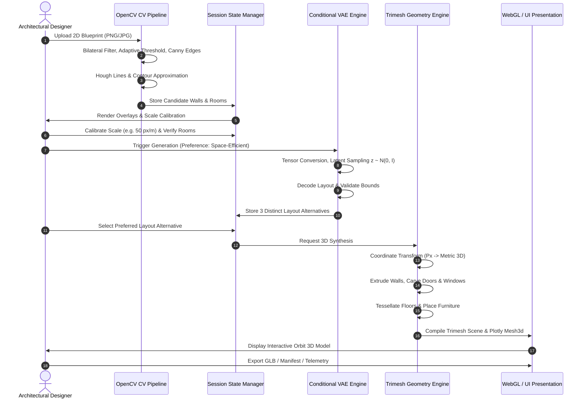

# SPAZE — Methodology & Technical Workflow

## 1. System Engineering Methodology
The engineering methodology of SPAZE is structured around a four-stage sequential pipeline with bidirectional human verification checkpoints.

---

## 2. Stage 1: Computer Vision Extraction Methodology
The computer vision subsystem solves the challenge of extracting structured architectural primitives from uncalibrated raster drawings.

### 2.1 Multi-Stage Preprocessing Pipeline
1. **Color Normalization**: Ingests raw bytes, validates magic bytes to prevent decompression bomb attacks, and converts the image to single-channel 8-bit grayscale $I(x, y) \in [0, 255]$.
2. **Noise Reduction**: Applies bilateral filtering or Gaussian smoothing. The bilateral filter preserves sharp wall edges while smoothing scanning grain:
   $$I_{\text{filtered}}(p) = \frac{1}{W_p} \sum_{q \in \Omega} I(q) f_r(\|I(p) - I(q)\|) g_s(\|p - q\|)$$
3. **Adaptive Binarization**: To handle uneven illumination and paper yellowing, local adaptive Gaussian thresholding determines the threshold $T(x, y)$ over a local neighbourhood window $B$:
   $$T(x, y) = \text{mean}(B(x, y)) - C$$
4. **Morphological Closing**: Applies a rectangular structural element ($3 \times 3$ or $5 \times 5$) using dilation followed by erosion to seal minor line discontinuities caused by scanning noise:
   $$A \bullet B = (A \oplus B) \ominus B$$
5. **Canny Edge Detection**: Calculates image gradients $\nabla I = \left(\frac{\partial I}{\partial x}, \frac{\partial I}{\partial y}\right)$ and identifies local maxima with hysteresis thresholding ($T_{\text{low}} = 50, T_{\text{high}} = 150$).

### 2.2 Structural Primitive Extraction
- **Wall Line Candidates**: Employs the Probabilistic Hough Transform (`cv2.HoughLinesP`). Extracted segments are clustered by slope angle $\theta$ into horizontal ($|\theta| \le 10^\circ$), vertical ($||\theta| - 90^\circ| \le 10^\circ$), and diagonal walls.
- **Candidate Room Extraction**: Analyzes connected background components and closed external contours. Contours exceeding a minimum area threshold ($A \ge 1{,}000\,\text{px}^2$) are approximated using the Douglas-Peucker polygon simplification algorithm:
  $$\epsilon = 0.02 \times \text{Perimeter}$$
  Bounding boxes $(x, y, w, h)$ are assigned initial heuristic classifications based on aspect ratio, relative floor area, and centroid location.

---

## 3. Stage 2: Generative AI Layout Synthesis Methodology
The generative subsystem models the conditional distribution of spatial room configurations given an input room program and architectural preference vector.

### 3.1 Input Tensor Representation
A floor plan containing $N$ rooms ($N \le M = 10$) is represented as a normalized tensor:
$$\mathbf{X} \in \mathbb{R}^{M \times 8}$$
Where each room vector contains:
$$\mathbf{r}_i = [x_{\text{norm}}, y_{\text{norm}}, w_{\text{norm}}, h_{\text{norm}}, c_1, c_2, c_3, \text{valid}]$$
- $x, y, w, h \in [0, 1]$: Min-max normalized coordinates relative to canvas dimensions.
- $c_1, c_2, c_3 \in \{0, 1\}$: Categorical one-hot embedding indicating room functionality (Private/Bedroom, Public/Living, Wet/Kitchen-Bath).
- $\text{valid} \in \{0, 1\}$: Mask indicating active vs padded room slots.

### 3.2 Conditioning Mechanism
Architectural intent is injected through a conditioning vector $\mathbf{c} \in \mathbb{R}^3$:
$$\mathbf{c}_{\text{space\_efficient}} = [1, 0, 0]^T, \quad \mathbf{c}_{\text{open\_layout}} = [0, 1, 0]^T, \quad \mathbf{c}_{\text{privacy\_focused}} = [0, 0, 1]^T$$

---

## 4. Stage 3: Procedural 3D Geometry Synthesis Methodology

### 4.1 Coordinate Normalization & Metric Transformation
Image raster coordinates (top-left origin, Y-down, pixels) are mapped into right-handed Cartesian 3D coordinates (center origin, Z-up, meters):
$$X_{3D} = \frac{x_{\text{px}} - W/2}{\text{PPM}}, \quad Y_{3D} = -\frac{y_{\text{px}} - H/2}{\text{PPM}}, \quad Z_{3D} \in [0, H_{\text{wall}}]$$
where $\text{PPM}$ is the calibrated pixels-per-meter scale factor.

### 4.2 Manifold Mesh Extrusion & Aperture Carving
- **Wall Extrusion**: Linear wall segments are buffered into 2D polygon footprints using Shapely and extruded along the Z-axis to height $H_{\text{wall}} = 2.80\,\text{m}$.
- **Aperture Subtraction**: For exterior walls, window apertures ($1.2\,\text{m} \times 1.4\,\text{m}$, sill height $0.9\,\text{m}$) are subtracted via boolean polygon slicing. Interior walls sharing boundaries between adjacent rooms receive door openings ($0.9\,\text{m} \times 2.1\,\text{m}$, sill height $0.0\,\text{m}$).
- **Floor Tessellation**: Room floor polygons are tessellated into planar triangles using the Mapbox-Earcut polygon triangulation algorithm, guaranteeing non-self-intersecting 2-manifold surfaces.
- **Proxy Furniture Placement**: Based on room classification, 3D procedural bounding proxies (boxes and cylinders) are placed with orientation aligned to the longest perimeter wall.
