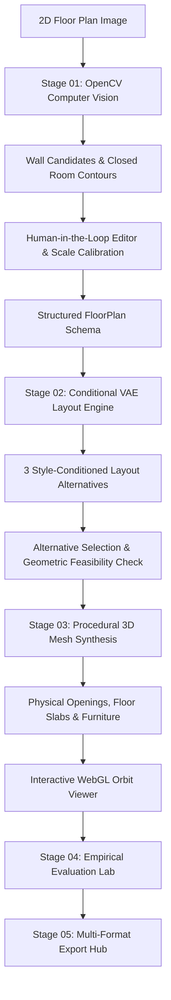

# SPAZE — Proposed System Specification

## 1. System Vision & Philosophy
**SPAZE** is engineered as a unified, production-conscious architectural workspace that transforms 2D floor-plan drawings into physically realizable, interactive 3D spatial environments. 

The architecture is built upon three core design principles:
1. **Local-First & Zero Cloud Dependencies**: All computer vision algorithms, neural network inferences, and 3D mesh tessellations execute strictly on local machine hardware (CPU/GPU) without transmitting proprietary client blueprints to third-party cloud APIs.
2. **Hybrid Generative-Geometric Synthesis**: Combines the expressive generative power and style controllability of deep learning (Conditional VAE) with the mathematical certainty and topological rigor of computational geometry (Trimesh, Shapely, Mapbox-Earcut).
3. **Continuous Architectural Workflow**: Bridges 2D image processing, interactive human-in-the-loop verification, generative AI layout synthesis, real-time 3D WebGL inspection, scientific benchmarking, and multi-format CAD export into a seamless single-page application.

---

## 2. End-to-End Pipeline Overview

---

## 3. High-Level Stage Descriptions

### Stage 00 — Workspace Overview
- Executive mission control dashboard displaying project statistics, pipeline status, active session telemetry, and one-click quick-start actions.

### Stage 01 — Floor Plan Studio
- Ingests raster drawings (PNG, JPG, JPEG) or pre-bundled architectural fixtures.
- Executes local OpenCV preprocessing: grayscale conversion, bilateral denoising, adaptive Gaussian binarization, Canny edge detection, morphological closing, Hough line detection, and contour extraction.
- Provides interactive scale calibration allowing users to define a real-world reference distance in meters.
- Includes a room editing inventory to adjust room labels, classifications, bounding dimensions, or add custom spatial polygons.

### Stage 02 — AI Layout Generator
- Converts the verified room program into a normalized spatial feature tensor.
- Employs the trained `SpazeCVAE` to generate three distinct layout alternatives conditioned on design preferences:
  - **Space-Efficient**: Maximizes compact clustering and minimizes dead circulation space.
  - **Open Layout**: Unifies living, dining, and kitchen zones with shared boundaries.
  - **Privacy-Focused**: Isolates bedroom and private sanctuaries with buffered corridor circulation.
- Evaluates spatial diversity ($1 - \text{IoU}$) and guarantees containment within the source building footprint.

### Stage 03 — 3D Visualization Studio
- Procedurally builds watertight 3D building models using Trimesh and Mapbox-Earcut.
- Features real-time parameter controls for wall height ($2.2\,\text{m} - 4.2\,\text{m}$), exterior wall thickness ($0.15\,\text{m} - 0.40\,\text{m}$), and interior partition thickness ($0.08\,\text{m} - 0.20\,\text{m}$).
- Automatically detects shared room boundaries and cuts physical door openings ($0.9\,\text{m} \times 2.1\,\text{m}$) and exterior window apertures ($1.2\,\text{m} \times 1.4\,\text{m}$).
- Synthesizes realistic floor finishes and non-colliding procedural furniture proxies.
- Renders directly in Streamlit via native Plotly WebGL Mesh3d graphics with layer visibility toggles and camera presets.

### Stage 04 — Evaluation Lab
- Empirically validates computer vision performance (Precision, Recall, F1, Mean Room IoU) against verified CAD ground truth.
- Provides full CVAE research telemetry: reconstruction loss, KL divergence, model parameter counts, and inference latency.
- Displays a head-to-head empirical benchmark table comparing the CVAE against a deterministic procedural baseline under identical spatial constraints.

### Stage 05 — Project Export Hub
- Delivers multi-format deliverables:
  - Binary glTF 2.0 (`.glb`) for Blender, Unreal Engine, Unity, and CAD viewers.
  - Structured Floor Plan Schema (`.json`).
  - 3D Building Specification Manifest (`.json`).
  - High-resolution 2D Blueprint preview (`.png`).
  - Scientific Benchmarking Telemetry (`.csv`).

### Stage 06 — Academic Research & Documentation
- Built-in technical documentation reader rendering all architectural specifications, mathematical formulations, and engineering reports directly in the workspace.
