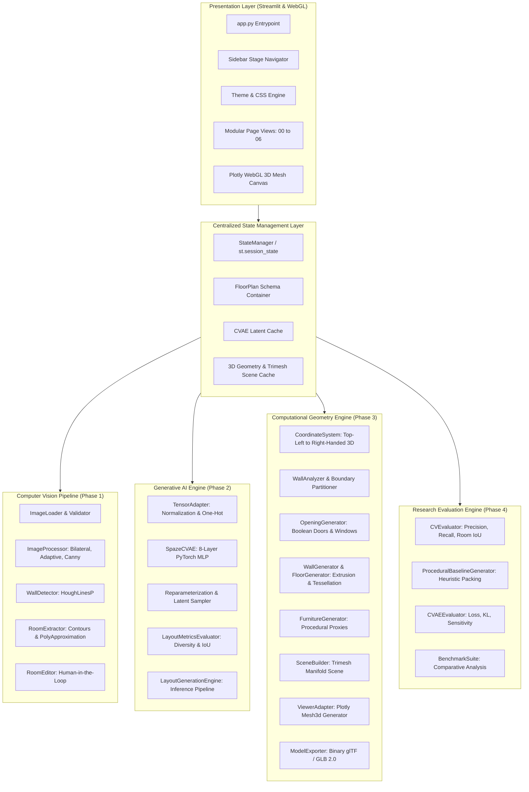

# SPAZE — System Architecture

## 1. Architectural Philosophy
The SPAZE system architecture follows a modular, decoupled, multi-tiered design pattern. Every subsystem communicates through strictly validated schema models, ensuring high testability, fault isolation, and horizontal extensibility.

---

## 2. Multi-Tier Architecture Diagram



---

## 3. Directory Structure & Module Breakdown

```
Staze-master/
├── app.py                      # Master Streamlit entry point and router
├── requirements.txt            # Locked dependency specifications
├── smoke_test.py               # Automated dependency and environment verification
│
├── config/                     # System-wide configuration constants
│   ├── __init__.py
│   └── settings.py             # Global canvas, threshold, room, and metric settings
│
├── models/                     # Shared domain entity schemas
│   ├── __init__.py
│   └── floorplan_schema.py     # Pydantic/dataclass schema for FloorPlan, Room, ScaleInfo
│
├── modules/                    # Phase 1: Local Computer Vision Preprocessing
│   ├── __init__.py
│   ├── image_loader.py         # Magic byte verification, local image ingestion
│   ├── image_processor.py      # Bilateral, adaptive Gaussian, Canny, morphology
│   ├── wall_detector.py        # Probabilistic Hough transform line extraction
│   ├── room_extractor.py       # Closed contour detection and polygon bounding
│   ├── room_editor.py          # Human-in-the-loop room correction logic
│   └── floorplan_parser.py     # Structured FloorPlan assembly and validation
│
├── cvae/                       # Phase 2: PyTorch Generative AI Engine
│   ├── __init__.py
│   ├── config.py               # Hyperparameters (latent dim=8, lr=1e-3, kl_weight=0.01)
│   ├── dataset.py              # Synthetic architectural dataset generator
│   ├── model.py                # SpazeCVAE PyTorch network architecture
│   ├── train.py                # Training loop with cyclic annealing and checkpoints
│   ├── infer.py                # Multi-alternative inference and sampling engine
│   ├── metrics.py              # Pairwise IoU, layout diversity, geometric validity
│   └── visualization.py        # 2D Matplotlib architectural layout visualizer
│
├── geometry3d/                 # Phase 3: Intelligent 3D Generation Engine
│   ├── __init__.py
│   ├── config.py               # Wall heights, thickness, aperture dimensions
│   ├── coordinate_system.py    # Pixel-to-metric right-handed transformation
│   ├── material_manager.py     # PBR materials, RGB colors, roughness
│   ├── wall_analyzer.py        # Boundary wall segmentation and classification
│   ├── opening_generator.py    # Door and window aperture coordinate calculation
│   ├── wall_generator.py       # 3D wall extrusion and boolean aperture subtraction
│   ├── floor_generator.py      # Floor slab tessellation via Mapbox-Earcut
│   ├── furniture_generator.py  # Procedural 3D furniture proxy synthesis
│   ├── scene_builder.py        # Trimesh scene compilation and validation
│   ├── viewer_adapter.py       # Native Plotly Mesh3d WebGL converter
│   ├── exporter.py             # Binary glTF 2.0 (.glb) and 2D blueprint export
│   ├── metrics.py              # Triangle budgets, vertex counts, usable area
│   ├── layout_validator.py     # Overlap detection, minimum dimension verification
│   └── model_generator.py      # Facade orchestrator for end-to-end 3D synthesis
│
├── evaluation/                 # Phase 4: Research Evaluation & Benchmarking
│   ├── __init__.py
│   ├── cv_evaluator.py         # Precision, Recall, F1, and Room IoU vs CAD ground truth
│   ├── baseline.py             # Deterministic procedural heuristic packing baseline
│   ├── cvae_evaluator.py       # ELBO loss, KL divergence, sensitivity diagnostics
│   └── benchmark_suite.py      # Head-to-head empirical comparison table generator
│
├── ui/                         # Light Architectural SaaS Interface
│   ├── __init__.py
│   ├── theme.py                # Light theme CSS design tokens (#F7F7F2, #4263EB)
│   ├── components.py           # Top header, workflow pipeline ribbon, metric cards
│   ├── state.py                # Centralized session state manager
│   ├── navigation.py           # Sidebar stage selector and project metadata
│   └── pages/                  # Modular stage page controllers
│       ├── __init__.py
│       ├── overview_page.py    # Stage 00: Workspace Overview
│       ├── floorplan_page.py   # Stage 01: Floor Plan Studio
│       ├── generation_page.py  # Stage 02: AI Layout Generator
│       ├── visualization_page.py # Stage 03: 3D Visualization Studio
│       ├── evaluation_page.py  # Stage 04: Evaluation Lab
│       ├── export_page.py      # Stage 05: Project Export Hub
│       └── docs_page.py        # Stage 06: Academic Research & Docs
│
├── checkpoints/                # Trained PyTorch neural network weights
│   └── spaze_cvae_best.pth     # Best-epoch model checkpoint (88.6 KB)
│
├── sample_data/                # Verified test fixtures and ground-truth CAD annotations
│   ├── sample_floorplan.png    # 800x600 2D residential floor-plan benchmark drawing
│   └── sample_ground_truth.json # Ground-truth wall vectors and room bounding polygons
│
├── docs/                       # Academic research documentation suite (17 chapters)
├── tests/                      # Automated pytest unit and integration test suite
└── presentation/               # College demonstration slides and script
```
